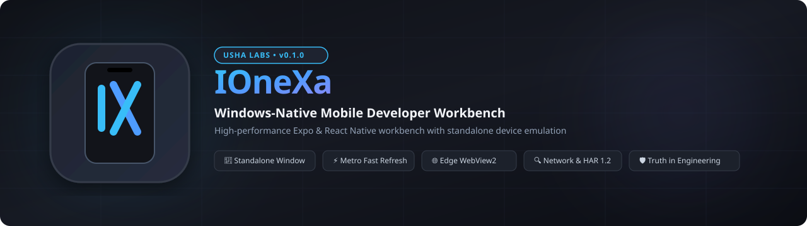

<p align="center">
  
</p>

<p align="center">
  
  
  
  
  
  
  
</p>

---

> [!IMPORTANT]
> **Truth in Engineering Disclosure:**  
> IOneXa executes real Expo and React Native projects using Expo's official web bundler target (`react-native-web` / Metro) embedded in a Windows-native shell powered by Microsoft Edge WebView2 and Qt 6.  
> **This is an Expo Web Preview, NOT an iOS runtime or iOS simulator.** It does not boot an iOS kernel, run compiled `.ipa` binaries, or emulate Apple-specific platform services (such as APNs, StoreKit, Apple Pay, Keychain, or native UIKit controls). For genuine iOS verification, tests must be executed on a physical iPhone (via Expo Go / QR code) or a macOS-hosted Apple Simulator.

---

## 1. Overview

**IOneXa** provides Windows developers with an integrated, zero-friction desktop workbench to inspect, run, preview, debug, and test Expo / React Native mobile applications directly on Windows without requiring a Mac or heavy emulator overhead.

### Key Capabilities
- **Decoupled Architecture:** Dual-window design featuring a modern IDE **Workbench** and an independent **Standalone Device Emulator Window** that can be positioned anywhere across multi-monitor setups.
- **Real Project Execution:** Runs unmodified Expo projects using their own local Metro bundler and Node toolchain with **Zero Project Mutation**.
- **Process Supervisor:** Win32 `CreateProcessW` bound to OS-level Windows Job Objects (`JOB_OBJECT_LIMIT_KILL_ON_JOB_CLOSE`) ensuring zero orphaned `node.exe` or `cmd.exe` processes.
- **Interactive Mobile Viewports:** 7 pre-calibrated device profiles (iPhone 14/15, 15 Pro Max, SE, Pixel 7, Galaxy S23, iPad Mini, Custom) with Dynamic Island, Home Indicator, orientation rotation, and CDP touch emulation.
- **Fast Refresh Bridge:** Live HMR log scraping and socket polling with automatic stale session recovery.
- **Diagnostics & Network Inspector:** Multi-source developer console (Metro, Browser DOM, System) and dual-layer network traffic capture with automated sensitive header redaction and HAR 1.2 export.
- **Compatibility Analyzer & iOS Handoff:** Identifies unsupported native modules and platform-split code (`*.ios.*` vs `*.web.*`), generating step-by-step physical iPhone and macOS Xcode handoff guides.

---

## 2. Architecture & Tech Stack

```
+-----------------------------------------------------------------------+
|                           IOneXa Workbench                            |
|  +------------+  +--------------------------------+  +--------------+ |
|  |  NavRail   |  |   Command Bar & Central Views  |  |  Inspector   | |
|  |  (Home,    |  |   - Project Workspace          |  |  Panel       | |
|  |   Projects,|  |   - Device Manager View        |  |  (Metrics,   | |
|  |   Devices, |  |   - Active Run Configurations  |  |   Compat,    | |
|  |   Console) |  |   - System Health Status       |  |   Handoff)   | |
|  +------------+  +--------------------------------+  +--------------+ |
|  +------------------------------------------------------------------+ |
|  | Collapsible Bottom Dock: [Console] [Network Inspector]           | |
+--+------------------------------------------------------------------+-+
                                   ▲
               Controlled Via Inter-Window Coordinator
                                   ▼
+-----------------------------------------------------------------------+
|                    Independent Device Emulator Window                 |
|  +-----------------------------------------+  +---------------------+ |
|  |       Calibrated Mobile Device Bezel    |  |  Adjacent Controls  | |
|  |   +---------------------------------+   |  |  - Power / Reload   | |
|  |   | Dynamic Island & Sensor Notch   |   |  |  - Rotate 90°       | |
|  |   | [ Edge WebView2 Mobile Canvas ] |   |  |  - Zoom / Fit / 1:1 | |
|  |   | Home Indicator Gesture Bar      |   |  |  - Screenshot       | |
|  |   +---------------------------------+   |  |  - Always on Top    | |
|  +-----------------------------------------+  +---------------------+ |
+-----------------------------------------------------------------------+
```

- **Desktop Shell:** C++20, Qt 6.8.2 MSVC 2022 x64 (Widgets with native Win32 HWND hosting).
- **Embedded Web Engine:** Microsoft Edge WebView2 Evergreen Runtime communicating over Chromium DevTools Protocol (CDP).
- **Process Orchestration:** Windows Job Objects with automatic pipe streaming and loopback port negotiation.
- **Design System:** Custom Android Studio / JetBrains–inspired dark theme (`#16181D` base, `#4E9CFF` primary accent).

---

## 3. Quick Start

### Prerequisites
- Windows 11 x64 or Windows 10 x64 (Version 1809+)
- Node.js v18.0.0+ LTS with npm
- Microsoft Edge WebView2 Evergreen Runtime (preinstalled on modern Windows)

### Running Pre-Built Portable Binary
1. Download `IOneXa-v0.1.0-windows-x64.zip` from Releases.
2. Extract to any directory.
3. Launch `ionexa.exe`.

### Building from Source
```cmd
:: Initialize Visual Studio 2022 64-bit developer tools
call "C:\Program Files (x86)\Microsoft Visual Studio\2022\BuildTools\VC\Auxiliary\Build\vcvars64.bat"

:: Configure with Ninja
cmake -B build -G Ninja -DCMAKE_BUILD_TYPE=Release -DCMAKE_PREFIX_PATH="C:\Qt\6.8.2\msvc2022_64"

:: Compile
ninja -C build

:: Run Unit Tests
ctest --test-dir build --output-on-failure
```

---

## 4. Development Phases & Roadmap

| Phase | Title | Status | Reports |
|---|---|---|---|
| Phase 0 | Feasibility Spike and Runtime Decision | Completed (PASS) | [PHASE_00.md](docs/PHASE_REPORTS/PHASE_00.md) |
| Phase 1 | Repository Foundation and Build System | Completed (PASS) | [PHASE_01.md](docs/PHASE_REPORTS/PHASE_01.md) |
| Phase 2 | Runtime Engine Contracts and Session Lifecycle | Completed (PASS) | [PHASE_02.md](docs/PHASE_REPORTS/PHASE_02.md) |
| Phase 3 | Expo Project Import and Environment Diagnostics | Completed (PASS) | [PHASE_03.md](docs/PHASE_REPORTS/PHASE_03.md) |
| Phase 4 | Metro Launch and Windows Process Management | Completed (PASS) | [PHASE_04.md](docs/PHASE_REPORTS/PHASE_04.md) |
| Phase 5 | Live Expo Application Preview Engine | Completed (PASS) | [PHASE_05.md](docs/PHASE_REPORTS/PHASE_05.md) |
| Phase 6 | Modern Windows Workspace and Design System | Completed (PASS) | [PHASE_06.md](docs/PHASE_REPORTS/PHASE_06.md) |
| Phase 7 | Fast Refresh Integration and Live Reload | Completed (PASS) | [PHASE_07.md](docs/PHASE_REPORTS/PHASE_07.md) |
| Phase 8 | Responsive Device Viewports and Input Simulation | Completed (PASS) | [PHASE_08.md](docs/PHASE_REPORTS/PHASE_08.md) |
| Phase 9 | Developer Console and Runtime Diagnostics | Completed (PASS) | [PHASE_09.md](docs/PHASE_REPORTS/PHASE_09.md) |
| Phase 10 | Network Inspector and Debugging Integration | Completed (PASS) | [PHASE_10.md](docs/PHASE_REPORTS/PHASE_10.md) |
| Phase 11 | Expo Module and iOS Compatibility Analyzer | Completed (PASS) | [PHASE_11.md](docs/PHASE_REPORTS/PHASE_11.md) |
| Phase 12 | Real-World Expo Feature Test Suite | Completed (PASS) | [PHASE_12.md](docs/PHASE_REPORTS/PHASE_12.md) |
| Phase 13 | Automated Preview Testing and Regression Suite | Completed (PASS) | [PHASE_13.md](docs/PHASE_REPORTS/PHASE_13.md) |
| Phase 14 | Reliability Performance and Security Hardening | Completed (PASS) | [PHASE_14.md](docs/PHASE_REPORTS/PHASE_14.md) |
| Phase 15 | Experimental Native React Native Runtime Research | Completed (PASS) | [PHASE_15.md](docs/PHASE_REPORTS/PHASE_15.md) |
| Phase 16 | Native iOS Verification Handoff and Reports | Completed (PASS) | [PHASE_16.md](docs/PHASE_REPORTS/PHASE_16.md) |
| Phase 17 | Windows Packaging and Developer Documentation | Completed (PASS) | [PHASE_17.md](docs/PHASE_REPORTS/PHASE_17.md) |
| Phase 18 | Real Application Pilot and Version 0.1 Release | Completed (PASS) | [PHASE_18.md](docs/PHASE_REPORTS/PHASE_18.md) |

---

## 5. GUI Redesign Roadmap (Android Studio Inspiration)

| GUI Phase | Title | Status | Scope |
|---|---|---|---|
| **GUI Phase 1** | Architecture Audit and Modern Design System | **Completed (PASS)** | Decoupled window architecture, design tokens (`theme.hpp/cpp`), README banner & branding |
| **GUI Phase 2** | Standalone Device Emulator Window | In Progress | Native top-level `DeviceEmulatorWindow`, aspect ratio preservation, scaling, window persistence |
| **GUI Phase 3** | Modern Development Workbench | Planned | Modular workbench, Android Studio–inspired command bar, navigation rail, central views |
| **GUI Phase 4** | Device Manager and Emulator Controls | Planned | Device Manager panel, custom profiles, adjacent emulator toolbar, screenshots |
| **GUI Phase 5** | Debugging Workspace and Session Inspector | Planned | Collapsible bottom tools dock, optional right-side inspector, honest status segregation |
| **GUI Phase 6** | UX Polish and Window Reliability | Planned | High-DPI multi-monitor resilience, keyboard shortcuts, error overlays, graceful window lifecycle |
| **GUI Phase 7** | Regression Testing and GUI Release Candidate | Planned | 20+ unit test suites, new GUI tests, real application acceptance test on `DeskFlow` |

---

## 6. License & Attribution

Copyright © 2026 Usha Labs. All rights reserved.  
Uses Qt 6 under LGPLv3 / Commercial compliance. Microsoft Edge WebView2 SDK is licensed under the Microsoft Software License.
