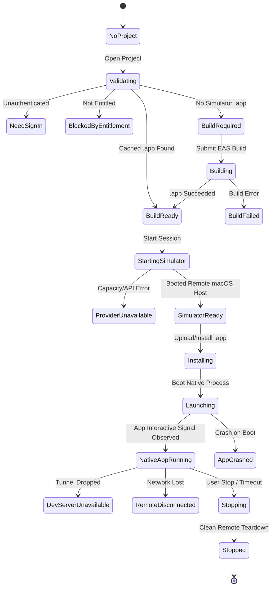

# ADR 0003: Native iOS Simulator Execution Architecture & Provider Strategy
**Document ID:** `docs/native-ios/ARCHITECTURE_DECISION_RECORD.md`  
**Status:** Accepted  
**Date:** October 28, 2026  
**Supersedes:** `docs/ADR/0001-runtime-strategy.md` (Expo Web as Primary MVP)  
**Clarifies:** `docs/ADR/0002-native-windows-react-native-runtime.md` (RNW strictly quarantined as non-iOS R&D)  
**Target Platform:** Windows 11 x64 / Windows 10 x64  
**Architect:** Antigravity (Principal React Native/Expo & Remote-Device Systems Engineer)

---

## 1. Context and Problem Statement

The previous runtime strategy (`ADR 0001`) designated **Expo Web** (running via `npx expo start --web` in an embedded Chromium WebView2 container) as the primary execution engine for IOneXa. Furthermore, `ADR 0002` explored **React Native for Windows** as a secondary native target.

Both approaches fundamentally fail the core product requirement:
> **IOneXa must enable a Windows developer to open an existing Expo/React Native project, produce or select a real native iOS Simulator build, launch that build on a genuine iOS simulator, interact with the running app, inspect failures, and test it before putting it on an iPhone.**

### Why Previous Approaches Failed:
1. **Expo Web (`react-native-web`) is NOT an iOS runtime:**
   - It compiles React components into HTML DOM elements.
   - It cannot execute native iOS modules (`react-native-screens`, `react-native-reanimated` native worklets, Keychain Services, StoreKit, Apple Authentication, CoreLocation).
   - It cannot test UIKit layout, safe area insets, native navigation controllers, or touch responder behaviors.
   - It provides no assurance that an application will compile or run on iOS.
2. **React Native Windows is NOT an iOS runtime:**
   - It targets WinUI 3 / UWP, using Microsoft Windows native controls.
   - It requires invasive project modifications (`react-native-windows-init`), pins dependencies to specific Windows toolchains, and does not support Expo iOS native modules.
3. **Local Windows Emulation of iOS is Technically Impossible without macOS:**
   - Apple's iOS Simulator requires macOS, the Darwin Mach kernel, and Apple private frameworks.
   - Any attempt to run Mach-O/UIKit binaries natively on Windows without macOS is an unfeasible research project with zero near-term guarantee for arbitrary Expo apps.

Therefore, authentic native iOS testing from a Windows desktop requires an **adapter-driven remote execution architecture** connecting Windows to genuine macOS-backed iOS Simulator infrastructure.

---

## 2. Upstream Technical Foundations & Verified Facts

### A. Real iOS Simulator Binaries via Expo EAS Build
- Expo EAS Build can compile genuine iOS Simulator `.app` bundles on Apple/macOS infrastructure from a Windows client.
- In `eas.json`, an iOS Simulator profile specifies:
  ```json
  {
    "build": {
      "simulator": {
        "developmentClient": true,
        "distribution": "internal",
        "ios": { "simulator": true }
      }
    }
  }
  ```
- This produces an x86_64 or arm64 iOS Simulator-compatible application directory or tarball, **not** a physical-device `.ipa`.

### B. Primary Provider: Expo EAS Simulator
- Expo provides early-access cloud-hosted iOS Simulators managed via the EAS CLI (`eas simulator:availability`, `simulator:start`, `simulator:get`, `simulator:control`, `simulator:stop`).
- An active session boots an authentic Apple iOS Simulator on remote macOS infrastructure and streams the display.
- Fast Refresh is supported by pairing a development build with a native Metro server (`npx expo start --dev-client`) and an Expo tunnel or egress proxy.
- **Access Gate:** Availability is subject to early-access entitlement and active Expo account authentication (`eas whoami`).

### C. Secondary Provider: Appetize.io Cloud Simulator
- Appetize is an established commercial platform providing genuine cloud-hosted iOS Simulators in interactive browser sessions.
- **Artifact Compatibility:** Directly accepts iOS Simulator `.app` directories compressed as `.tar.gz` or `.zip`. Explicitly rejects production `.ipa` binaries for simulator sessions.
- **Integration:** Provides an official JavaScript SDK and embeddable `iframe` viewer supporting touch, text input, hardware keys, rotation, and lifecycle events.
- Can be securely hosted inside Microsoft Edge WebView2 on Windows.

---

## 3. Decision Matrix

| Evaluation Criteria | Weight | Provider A: Expo EAS Simulator | Provider B: Appetize.io | Rejected: Expo Web | Rejected: RN Windows |
|---|---|---|---|---|---|
| **Runs Genuine iOS Binary** | 35% | **10 / 10** (Real `.app` on macOS) | **10 / 10** (Real `.app` on macOS) | 0 / 10 (HTML DOM) | 0 / 10 (WinUI 3) |
| **Expo Ecosystem Integration** | 20% | **10 / 10** (Native EAS integration) | 7 / 10 (Requires upload step) | 8 / 10 (Expo CLI) | 1 / 10 (Breaks Expo) |
| **Windows Remote Stream** | 15% | **8 / 10** (CLI/Web streaming) | **9 / 10** (Documented JS SDK/iframe) | 9 / 10 (Direct WebView2) | 8 / 10 (Direct HWND) |
| **Fast Refresh Support** | 15% | **9 / 10** (Dev client + tunnel) | 4 / 10 (Static app upload) | 9 / 10 (Web HMR) | 5 / 10 (Windows HMR) |
| **Availability / Zero Waitlist** | 15% | 5 / 10 (Entitlement-gated) | **9 / 10** (Immediate API availability) | 10 / 10 (Local) | 3 / 10 (Complex build) |
| **Weighted Total** | 100% | **8.70 / 10** | **8.20 / 10** | **3.65 / 10** (DISQUALIFIED) | **2.60 / 10** (DISQUALIFIED) |

---

## 4. Architectural Decision: The Adapter-Driven Hybrid Model

IOneXa adopts an **adapter-driven remote simulator architecture**:

```
+========================================================================+
|                       IOneXa Windows Host (Qt 6.8 / C++20)             |
+========================================================================+
| [ProjectInspector] -> Parses app.json, eas.json, native modules, bundleId|
| [CredentialBroker] -> Private auth check; NO credentials in logs/repo   |
| [BuildCoordinator] -> Manages EAS native iOS simulator builds (.app)    |
| [SimulatorSessionManager] -> State machine orchestrator                 |
|       |                                                                |
|       +---> ISimulatorProvider (Abstract Adapter Contract)             |
|       |        |                                                       |
|       |        +-- [ExpoEASSimulatorProvider] (Primary / Entitled)     |
|       |        +-- [AppetizeSimulatorProvider] (Fallback / Universal)  |
|       |                                                                |
| [INativeDevServer] -> npx expo start --dev-client + Tunnel/Egress      |
| [StreamViewerHost] -> Embedded WebView2 remote stream or signed viewer |
+========================================================================+
                                   |
                Encrypted Network / HTTPS / WebSocket
                                   |
                                   v
+========================================================================+
|               Supported macOS Remote Infrastructure                    |
+========================================================================+
| [Authentic Apple iOS Simulator]                                        |
|   - Executes Mach-O Simulator Binary (.app)                            |
|   - Real UIKit, CoreAnimation, CoreGraphics, Foundation                |
|   - Native Fast Refresh connection back to Windows Metro dev server    |
|   - Interactive Video / Event Stream back to Windows IOneXa            |
+========================================================================+
```

### Truth-in-Labeling Rules:
1. **Never Claim Local iOS Execution:** All UI surfaces, status bars, and exported logs must explicitly disclose the remote provider (e.g. `Provider: Expo EAS Simulator (Cloud macOS)` or `Provider: Appetize.io`).
2. **Never Call Web "iOS":** Expo Web execution is quarantined and removed from the native iOS verification path.
3. **Hardware Limitations Disclosed:** Clearly document features unsupported in simulators vs. physical hardware (remote APNs push, biometric hardware authentication, real camera hardware, Bluetooth peripheral advertising).

---

## 5. Session State Model

The session state machine is redesigned to reflect the exact physical and network lifecycle of remote iOS simulation:



### Required States:
- `NoProject`: No valid React Native / Expo directory loaded.
- `Validating`: Checking project configuration, bundle ID, credentials, and provider entitlement.
- `NeedSignIn`: Expo or Appetize credentials missing; prompts user without exposing secrets.
- `BlockedByEntitlement`: Provider accounts lack simulator access.
- `PaymentApprovalRequired`: Explicit approval needed before incurring cloud usage charges.
- `BuildRequired`: Project lacks a simulator-compatible `.app` build.
- `Building`: Compiling native iOS Simulator binary on EAS remote macOS infrastructure.
- `BuildFailed`: Compilation error; surfaces actual Xcode build logs.
- `BuildReady`: Valid simulator `.app` artifact verified.
- `StartingSimulator`: Requesting remote simulator boot.
- `SimulatorReady`: Remote simulator OS ready to receive applications.
- `Installing`: Deploying `.app` bundle onto the remote simulator.
- `Launching`: Spawning the application binary.
- `NativeAppRunning`: Application active; confirmed by visible rendering and interaction capability.
- `Stopping`: Initiating remote session teardown.
- `Stopped`: Confirmed remote resource deallocation.
- `CleanupFailed`: Warning if remote session could not be confirmed stopped.

---

## 6. Provider Interface Proposal (C++20)

The interface contracts are formally defined in `src/engines/simulator_provider_interface.hpp`:

1. **`ISimulatorProvider`**:
   - `probeAvailability()`: Detects account access, entitlement, and provider health.
   - `getSupportedDevices()`: Queries available iPhone/iPad models and iOS versions.
   - `startSession(buildArtifact, targetDevice, outSession)`: Boots the remote simulator.
   - `pollSessionState(sessionId)`: Monitors remote session lifecycle.
   - `launchApplication(sessionId, bundleId, devUrl)`: Launches the native binary.
   - `getApprovedViewer(sessionId)`: Provides the secure stream endpoint for WebView2.
   - `captureScreenshot(sessionId)`: Retrieves a remote framebuffer snapshot with provenance.
   - `retrieveLogs(sessionId)`: Retrieves native system and application logs.
   - `stopSession(sessionId)`: Confirms remote teardown.

2. **`IBuildProvider`**:
   - `checkNativeBuildPrerequisites(projectDir)`: Validates `app.json`, `bundleIdentifier`, and `eas.json`.
   - `submitSimulatorBuild(projectDir, profile)`: Dispatches remote EAS build.
   - `pollBuild(buildId)`: Tracks remote compilation status.
   - `downloadSimulatorArtifact(buildId, destDir)`: Downloads `.app.tar.gz` for fallback providers.

3. **`INativeDevServer`**:
   - `startNativeMetro(projectDir, preferredPort)`: Spawns native Metro (`--dev-client`).
   - `makeAccessibleToRemoteSimulator(port)`: Configures public tunnel or egress proxy.
   - `awaitClientConnection(timeoutMs)`: Verifies development client WebSocket handshake.
   - `stopOwnedProcessOnly()`: Clean process termination without killing unrelated Node tasks.

---

## 7. Security and Privacy Policy

1. **Zero Credential Ingestion in Git:**
   - `.env.eas-simulator*`, `*.token`, `*.token.json`, `eas-credentials.json` are strictly added to `.gitignore`.
   - Diagnostics, bug reports, and logs redact any stdout tokens, passwords, or session cookies.
2. **Explicit Financial Consent:**
   - IOneXa will never silently trigger paid builds, Appetize paid minute consumption, or EAS billable operations without an explicit user confirmation dialog displaying estimated costs.
3. **Leak-Free Process Ownership:**
   - Only processes and remote sessions created by IOneXa are stopped or modified. No generic `taskkill /IM node.exe` or termination of user-owned background simulators.

---

## 8. Migration and Gated Roadmap

- **Phase 19:** Baseline Audit and Architecture Reset (Current Phase).
- **Phase 20:** Live Provider Entitlement and Native Build Feasibility.
- **Phase 21:** First Real Expo iOS App Running on Simulator (Proof-of-Execution Stop-and-Show Gate).
- **Phase 22:** Native Build + Session Lifecycle Integration.
- **Phase 23:** Authorized Windows Viewer and Input Integration.
- **Phase 24:** Native Metro, Fast Refresh, Diagnostics and Recovery.
- **Phase 25:** Real Project Validation and Honest Release Readiness.
- **Optional Phase 26:** React Native Windows Fabric Research (Separate Approval).
